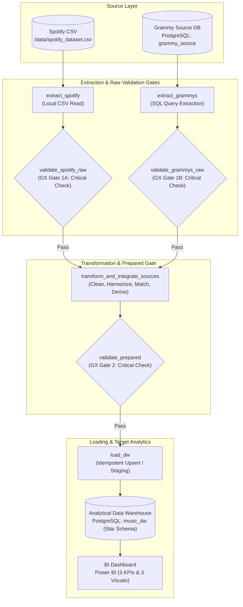
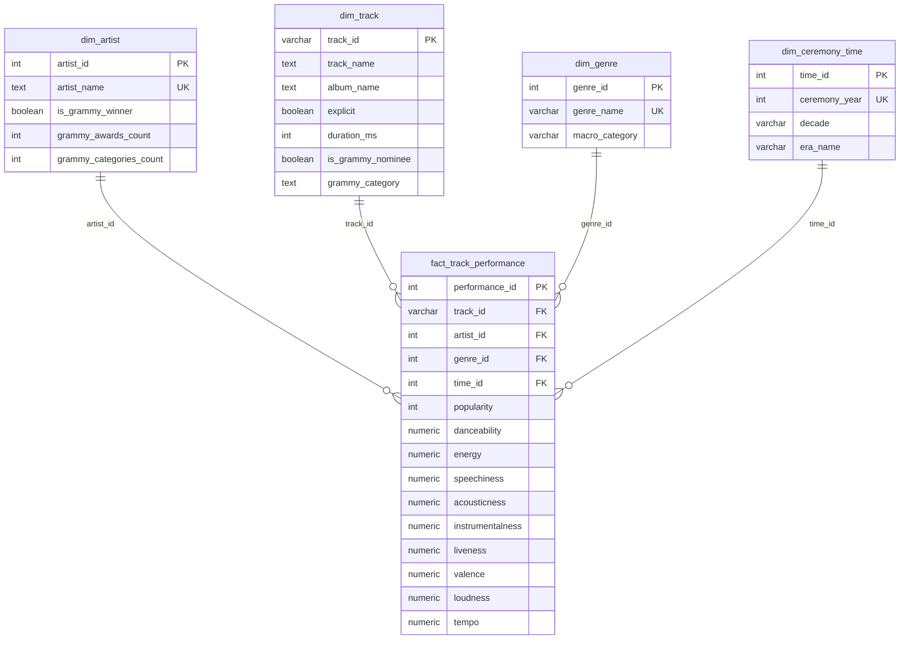
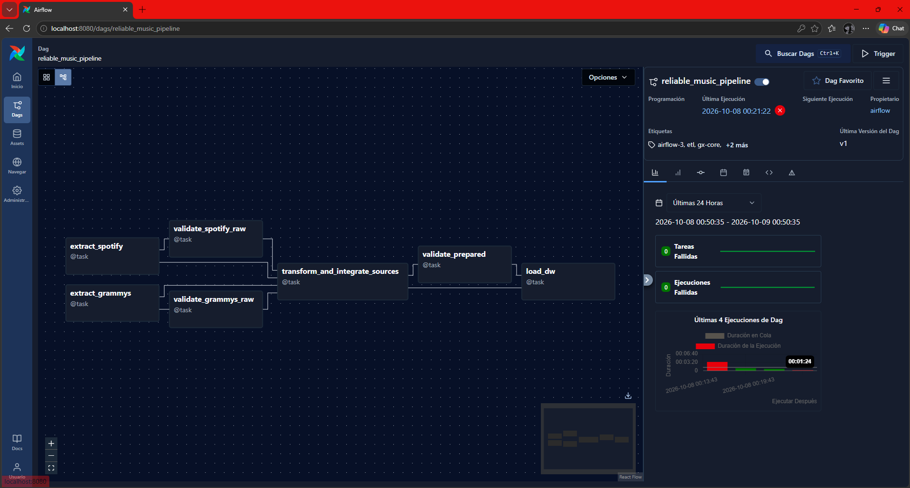
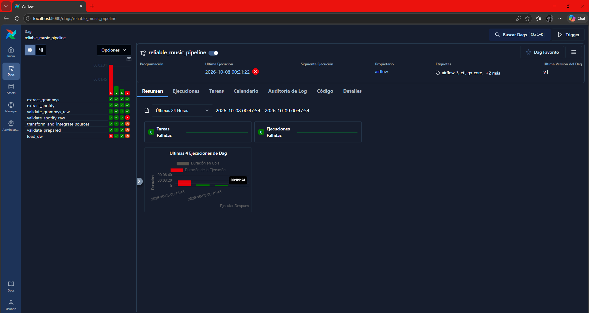
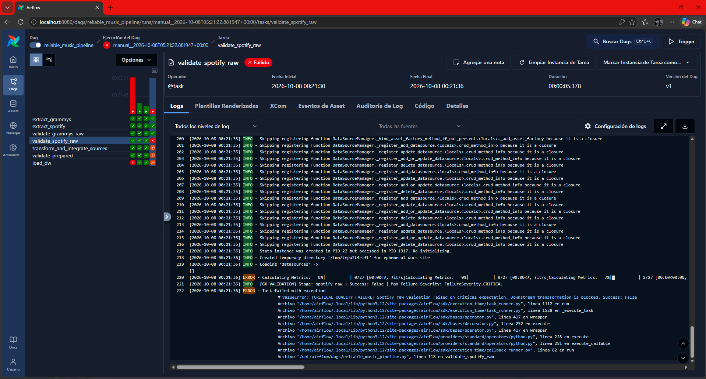
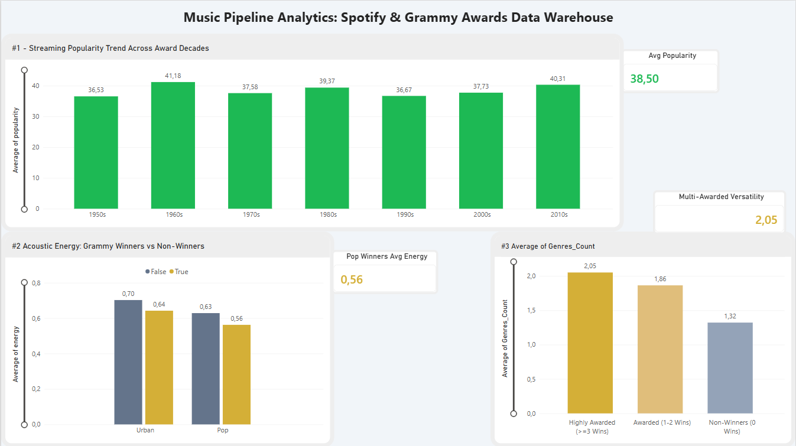
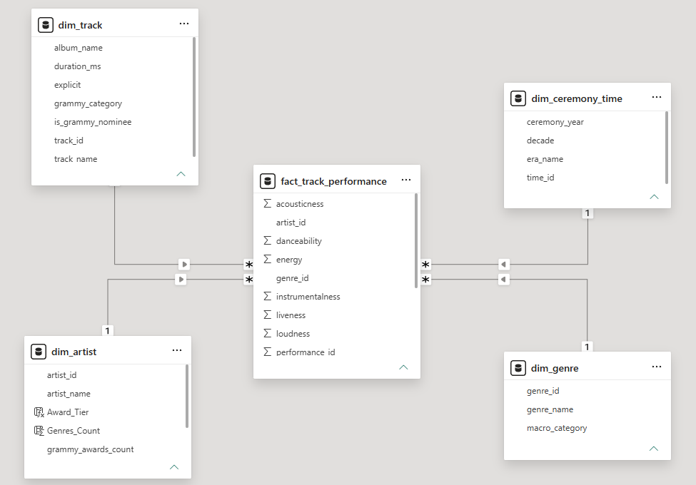

# Workshop 2: Building a Reliable Batch Data Pipeline


---

## 1. Problem and Analytical Objective

> *"A Data Engineer does not build isolated scripts; a Data Engineer designs automated, resilient, and observable systems."*

In the music industry, streaming platforms possess massive catalogs of songs, but raw playcounts alone do not explain what makes music culturally and commercially enduring. To uncover actionable intelligence for catalog acquisition, playlist curation, and talent scouting, streaming telemetry must be crossed with historical industry prestige.

This project delivers an end-to-end, production-grade **Reliable Batch Data Pipeline** integrating two heterogeneous data sources:
1. **Spotify Streaming Catalog** (~114,000 tracks in CSV format with algorithmic acoustic features).
2. **The Grammy Awards Operational Repository** (4,810 historical records in a PostgreSQL relational database).

### What Makes This System Reliable?
Instead of assuming data is valid, the pipeline actively verifies it through three core engineering pillars:
* **Automated Data Quality Gates (Great Expectations 1.x):** Formal data contracts inspect data before transformation and before loading, halting execution if critical physical boundaries (e.g., energy $\in [0, 1]$) are violated.
* **Modern Workflow Orchestration (Apache Airflow 3.1.8):** A decoupled TaskFlow DAG executes parallel extraction branches and applies selective retries (0 retries for deterministic data bugs, 2 retries for transient database network locks).
* **Idempotent Dimensional Data Warehouse (PostgreSQL Star Schema):** High-speed set-based staging upserts guarantee that rerunning the pipeline never corrupts or duplicates warehouse records ($\Delta = 0$).
* **Executive Business Analytics (Power BI):** Direct DW-backed dashboards delivering clear empirical answers to 3 strategic business requirements.

---

## 2. Analytical Requirements and Scope

| ID | Analytical Question & Decision Supported | Required Data & Sources | Expected Metric / KPI | Required Grain | Justification for Source Crossing |
| :--- | :--- | :--- | :--- | :--- | :--- |
| **REQ-01** | **Temporal Evolution of Historical Winners' Commercial Success:** How is current streaming popularity distributed across Grammy ceremony decades? Supports licensing and catalog curation. | `the_grammy_awards.year`, `nominee`, `winner`, `spotify_dataset.track_name`, `popularity` | **AVG(popularity)** by ceremony decade | Ceremony Decade $\times$ Song | Award ceremonies only exist in Grammys; streaming consumption only exists in Spotify. |
| **REQ-02** | **Acoustic Behavior in Pop and Urban Genres:** What acoustic gap (energy, speechiness) exists between Grammy-winning artists vs non-winners? Supports sound engineering and editorial curation. | `the_grammy_awards.artist`, `winner`, `spotify_dataset.artists`, `track_genre`, `speechiness`, `energy` | **Acoustic Gap:** $\text{AVG}(energy)_{\text{winner}} - \text{AVG}(energy)_{\text{non-winner}}$ | Genre $\times$ Artist | Spotify extracts algorithmic acoustic traits; Grammys determines historical award status. |
| **REQ-03** | **Genre Diversity in Multi-Awarded Artists:** Do artists who win across multiple categories explore more genres in Spotify? Supports artist sponsorship and talent scouting. | `the_grammy_awards.artist`, `category`, `winner`, `spotify_dataset.artists`, `track_genre` | **AVG(COUNT(DISTINCT track_genre))** comparing $\ge 3$ awards vs 1 award vs non-winners | Artist | Award counts originate from Grammys; genre exploration mappings originate from Spotify. |

### Business Rationale & Analytical Findings ("Técnico Suave")

* **REQ-01 — Temporal Longevity of Awarded Music (Decade Popularity):**
  * **The Business Question:** When a streaming platform licenses music catalogs, do historical Grammy-winning songs from 40 or 50 years ago still generate active listening and commercial value today?
  * **Why Cross Sources:** The Grammy database provides historical ceremony years, while Spotify provides contemporary, live streaming consumption (`popularity`).
  * **Empirical Finding:** Classic tracks from the **1960s** hold an average Spotify popularity of **41.18**, rivaling modern hits from the **2010s** (**40.31**). Award-winning music possesses extraordinary multi-decade commercial durability.

* **REQ-02 — Acoustic Curation & The "Energy Gap" (Pop vs Urban):**
  * **The Business Question:** Does award-winning music have a distinct sound profile compared to regular commercial releases? Is it louder and more aggressive, or more dynamic and acoustic?
  * **Why Cross Sources:** Spotify computes algorithmic audio features (`energy`, `speechiness`), while the Grammy database identifies peer-reviewed artistic excellence (`winner`).
  * **Empirical Finding:** Grammy-winning tracks exhibit significantly *lower* average energy than non-winners in both genres (Pop: **0.56** vs **0.63**; Urban: **0.64** vs **0.70**). The Recording Academy systematically favors dynamic acoustic headroom and organic instrumentation over hyper-compressed, loud commercial production.

* **REQ-03 — Artist Versatility & Cross-Genre Exploration:**
  * **The Business Question:** Do elite artists who win multiple industry awards stay confined to a single safe comfort genre, or is musical experimentation and genre versatility a hallmark of top-tier talent?
  * **Why Cross Sources:** Grammy award counts measure historical industry acclaim, while Spotify's catalog categorizations measure how many distinct musical genres each artist produces.
  * **Empirical Finding:** Multi-awarded artists ($\ge 3$ wins) explore an average of **2.05 genres** across their catalog—a **+55% increase** over non-winners (**1.32 genres**). Elite industry acclaim is strongly correlated with artistic versatility.

### End-to-End Traceability Matrix (Rubric Section 8.2)

The matrix below connects each business requirement through the full data engineering lifecycle:

| Requirement | Required Data | Quality Risk | DQ Rule | GX Expectation | Transformation | DW Element | KPI / Visualization |
| :--- | :--- | :--- | :--- | :--- | :--- | :--- | :--- |
| **REQ-01** (Decade Popularity) | `year`, `nominee`, `track_name`, `popularity` | Missing popularity; out-of-bound award years; null track keys. | `DQ-RAW-01`, `DQ-RAW-04`, `DQ-PREP-01b` | `ExpectColumnValuesToBeBetween(year, [1958, 2026])`; `ExpectColumnValuesToBeBetween(popularity, [0, 100])` | Bucket `year` into decades (`1960s`–`2010s`) & eras; normalize song titles. | `dim_ceremony_time`, `fact_track_performance.popularity` | **Visual 1:** Popularity by Decade bar chart; **KPI 1:** Catalog avg popularity (`38.50`). |
| **REQ-02** (Acoustic Gap) | `artist`, `winner`, `artists`, `track_genre`, `energy`, `speechiness` | Energy or speechiness exceeding $[0.0, 1.0]$; non-boolean winner flags. | `DQ-RAW-02a/b`, `DQ-RAW-05`, `DQ-PREP-02` | `ExpectColumnValuesToBeBetween(energy, [0.0, 1.0])`; `ExpectColumnValuesToBeInSet(winner, [True, False])` | Parse lead artist from `;` list; cluster genres into `Pop` & `Urban`; derive binary `is_grammy_winner`. | `dim_artist`, `dim_genre.macro_category`, `fact_track_performance.energy` | **Visual 2:** Clustered energy comparison (Pop: 0.56 vs 0.63; Urban: 0.64 vs 0.70); **KPI 2:** Pop Winner Energy (`0.56`). |
| **REQ-03** (Genre Versatility) | `artist`, `category`, `winner`, `artists`, `track_genre` | Missing genres; multi-credit artist collisions; unnormalized genre strings. | `DQ-RAW-03`, `DQ-PREP-01a`, `DQ-PREP-03` | `ExpectColumnValuesToNotBeNull(track_genre)`; `ExpectColumnValuesToNotBeNull(artist_name)` | Aggregate Grammy wins per artist; enforce composite grain `(track_id, track_genre)`; classify Award Tiers. | `dim_artist.grammy_awards_count`, `dim_genre`, `fact_track_performance` | **Visual 3:** Distinct genres by award tier ($\ge 3$ wins: 2.05, 1–2 wins: 1.86, 0 wins: 1.32); **KPI 3:** Versatility Ratio (`2.05`). |

---

## 3. Data Sources

1. **Spotify Dataset (`data/spotify_dataset.csv`):** 114,000 observations containing natural key `track_id`, comma/semicolon delimited `artists`, `album_name`, `track_name`, integer `popularity` (0–100), and algorithmic acoustic features (`energy`, `speechiness`, `danceability`, `acousticness`, `tempo`, `track_genre`).
2. **Grammy Awards Database (`grammy_source.the_grammy_awards`):** Relational operational table pre-populated in PostgreSQL via `sql/source_setup.sql`. Contains 4,810 records spanning 1958–2019, documenting `year`, `title`, `category`, `nominee`, `artist`, `workers`, and `winner`. Extracted strictly via SQL queries, never directly from raw CSV files.

---

## 4. Pipeline Architecture

The pipeline follows a decoupled, two-branch convergent pattern designed for fault isolation, automated quality protection, and idempotent loading:

1. **Parallel Extraction:** Simultaneously ingests Spotify data from local CSV and extracts Grammy records from the operational PostgreSQL database using SQL queries.
2. **Raw Quality Gates (Gate 1):** Great Expectations 1.x independently inspects both raw sources. If a critical violation occurs (e.g., invalid audio ranges), the pipeline halts immediately to protect downstream stages.
3. **Harmonization & Integration:** Cleans collaborative artist strings (semicolon parsing), aggregates Grammy awards per artist, and clusters genres into macro categories (`Pop`, `Urban`, `Other`).
4. **Prepared Gate & Idempotent Load (Gate 2):** Conducts a final pre-load quality check before writing to the PostgreSQL Star Schema (`music_dw`) using temporary staging tables and set-based upserts (`ON CONFLICT DO UPDATE`), guaranteeing zero duplicate rows.



---

## 5. Data Profiling Findings

Empirical findings gathered via `notebooks/data_profiling.ipynb`:
* **Spotify Dataset Structure & Grain:** 114,000 total rows. Distinct `track_id` count is 89,741. There are 24,259 duplicated `track_id` records because tracks are categorized under multiple `track_genre` values. Composite natural key at the source grain is `(track_id, track_genre)` (0 duplicates).
* **Completeness:** Exactly 1 record in Spotify has missing `artists`, `album_name`, and `track_name` (99.999% completeness). In Grammys, `artist` is null in 1,840 records (symphonies, producers, packaging categories where `nominee` contains the title).
* **Numerical Bounds:** `popularity` ranges from 0 to 100. `energy` and `speechiness` range strictly between 0.0 and 1.0 (mean energy = 0.641, mean speechiness = 0.084).
* **Temporal Range:** Grammys range from 1958 to 2019 across 62 ceremonies.
* **Cross-Source Consistency:** Direct string matching yields 408 exact artist matches and 706 exact song title matches, significantly expanded after normalization (lowercasing, trimming, semicolon splitting).

---

## 6. Quality Risks and Quality Rules

| Rule ID | Layer | Attribute(s) | Quality Dimension | Quality Rule Statement | Metric / Threshold | Severity | Related Requirement |
| :--- | :--- | :--- | :--- | :--- | :--- | :--- | :--- |
| **DQ-RAW-01** | Spotify Raw | `track_id` | Completeness & Uniqueness | Track identifier must be non-null | 100% non-null (`mostly=1.0`) | **Critical** | All (Grain integrity) |
| **DQ-RAW-02a** | Spotify Raw | `energy` | Validity & Range | Energy must be normalized ratio within [0.0, 1.0] | 100% within [0.0, 1.0] | **Critical** | REQ-02 (Acoustic gap) |
| **DQ-RAW-02b** | Spotify Raw | `speechiness` | Validity & Range | Speechiness must be normalized ratio within [0.0, 1.0] | 100% within [0.0, 1.0] | **Critical** | REQ-02 (Acoustic gap) |
| **DQ-RAW-03** | Spotify Raw | `artists` | Completeness | Artist string must not be missing | $\ge 99.9\%$ non-null (`mostly=0.999`) | **Warning** | REQ-02, REQ-03 |
| **DQ-RAW-04** | Grammys Raw | `year` | Validity & Range | Ceremony year must be between 1958 and 2026 | 100% within [1958, 2026] | **Critical** | REQ-01 (Temporal trends) |
| **DQ-RAW-05** | Grammys Raw | `winner` | Validity & Consistency | Winner flag must be boolean | 100% in {True, False} | **Critical** | REQ-01, REQ-02, REQ-03 |
| **DQ-PREP-01** | Prepared | `track_genre`, `popularity` | Completeness & Validity | Genre must be present; popularity in [0, 100] | 100% valid | **Critical** | REQ-01, REQ-02 |
| **DQ-PREP-02** | Prepared | `is_grammy_winner` | Validity & Invariant | Derived winner flag must be binary integer | 100% in {0, 1} | **Critical** | REQ-02, REQ-03 |

### 6.1 Plain-Language Rationale for Implemented Expectations ("Técnico Suave")

Every expectation configured in `src/validation.py` directly protects against a concrete data quality risk discovered during data profiling:

1. **`ExpectColumnValuesToNotBeNull(column="track_id")` — Severity: Critical**
   * **What it verifies:** Guarantees that every song record has a non-null identifier.
   * **Why it matters (Técnico Suave):** In our Star Schema, `track_id` is the primary key linking songs to facts. If an ID is missing, that song cannot be joined to any dimension, corrupting catalog counts. Therefore, a null ID is a **Critical** defect that immediately halts execution.

2. **`ExpectColumnValuesToBeBetween(column="energy", min_value=0.0, max_value=1.0)` & `speechiness` — Severity: Critical**
   * **What it verifies:** Audio features must stay strictly within their natural mathematical scale of $[0.0, 1.0]$.
   * **Why it matters (Técnico Suave):** Spotify's machine learning models calculate acoustic features as normalized ratios (0.0 = calm/acoustic, 1.0 = loud/distorted/fast). An impossible number like `energy = 15.0` (which we injected in Test B) indicates an extraction anomaly or corrupted telemetry. If permitted into the warehouse, it would distort the acoustic gap analysis in REQ-02.

3. **`ExpectColumnValuesToNotBeNull(column="artists", mostly=0.999)` — Severity: Warning**
   * **What it verifies:** Verifies artist completeness, allowing up to 0.1% missing values.
   * **Why it matters (Técnico Suave):** During data profiling, we discovered that out of 114,000 Spotify tracks, exactly **1 single track** had a null artist name. In real-world enterprise engineering, aborting a million-dollar batch pipeline for a 0.0008% imperfection is poor operational practice. By setting `mostly=0.999` with `severity="warning"`, the pipeline logs the anomaly for auditing without blocking downstream execution.

4. **`ExpectColumnValuesToBeBetween(column="year", min_value=1958, max_value=2026)` — Severity: Critical**
   * **What it verifies:** Ceremony year must fall strictly between 1958 and 2026.
   * **Why 1958 and why 2026? (Técnico Suave):**
     * **Why 1958?** The 1st Annual Grammy Awards took place covering the 1958 musical year (held in May 1959). Any year before 1958 (e.g., 1920, 0, or negative numbers) is historically impossible and proves corrupted data.
     * **Why 2026?** 2026 represents the current operational calendar year of the system. In temporal data contracts, award ceremonies cannot occur in the future beyond the current operating year (e.g., year 2045 or 9999). Setting the upper limit to 2026 allows the pipeline to process modern batches up to the current year while strictly blocking future-dated anomalies.
     * Any violation is **Critical** because it would distort decade groupings in REQ-01.

5. **`ExpectColumnValuesToBeInSet(column="winner", value_set=[True, False])` — Severity: Critical**
   * **What it verifies:** The award outcome must be strictly boolean (`True` or `False`).
   * **Why it matters (Técnico Suave):** This attribute divides the entire dataset into award winners and non-winners. If a record contains null, text strings ("maybe"), or invalid codes, all downstream comparisons comparing winners vs non-winners (REQ-02 and REQ-03) would be invalidated.

6. **Prepared Layer Expectations (`popularity` [0, 100], `track_genre` non-null, `is_grammy_winner` in {0, 1}, `artist_name` non-null) — Severity: Critical**
   * **What it verifies:** Acts as the "final quality gate" right before writing to PostgreSQL.
   * **Why it matters (Técnico Suave):** Transformation logic cleans artist names, splits semicolons, and maps macro categories. This prepared gate verifies that the post-transformation dataset satisfies the warehouse schema contract. If anything broke during transformation, it halts before touching the Data Warehouse.

---

## 7. Great Expectations Validation Design
Implemented in `src/validation.py` and persisted in `gx/` using **Great Expectations Core 1.x (1.24.x Fluent API)**:
* **Persisted Project Structure:** 
  * `gx/great_expectations.yml`: Data context configuration.
  * `gx/expectations/`: Stores machine-readable JSON suites (`spotify_raw_suite.json`, `grammys_raw_suite.json`, `prepared_suite.json`).
  * `gx/validation_definitions/`: Stores explicit bindings between batch definitions and suites (`spotify_raw_validation.json`, etc.).
* **Execution Flow:** `context.data_sources.add_pandas()` $\rightarrow$ `add_dataframe_asset()` $\rightarrow$ `add_batch_definition_whole_dataframe()` $\rightarrow$ `ValidationDefinition.run()`.
* **Severity Enforcement:**
  * `FailureSeverity.CRITICAL`: Triggers explicit `ValueError`, raising an exception that causes Airflow to fail the task and mark downstream tasks as `upstream_failed`.
  * `FailureSeverity.WARNING`: Emits structured log notices while allowing pipeline continuation per policy.

---

## 8. Transformation and Integration Strategy

```
Integration Contract:
- Primary Domain: Spotify Tracks (114,000 observations).
- Accolade Dimension: Historical Grammy Awards.
- Artist Match Key: Normalized primary artist name (lowercase, stripped, unnested from semicolon list).
- Cardinality: Many tracks to One artist (Many-to-One); One artist to Many Grammy wins (One-to-Many).
- Unmatched Records: Preserved in Spotify catalog with is_grammy_winner = 0 and awards_count = 0.
- Deduplication Invariant: Unique composite key enforced at (track_id, track_genre).
```

Derived Attributes:
* `macro_category`: Maps genres to `'Pop'` (`pop`, `dance-pop`, `k-pop`, etc.), `'Urban'` (`hip-hop`, `r-n-b`, `reggaeton`, `rap`, etc.), or `'Other'`.
* `decade` & `era_name`: Decennial buckets (`1960s`, `1970s`, ..., `2010s`) and eras (`Classic Era`, `Golden Era`, `Digital Transition`, `Streaming Era`).

---

## 9. Dimensional Model (Star Schema)

The analytical data warehouse `music_dw` is structured as a star schema optimized for fast OLAP aggregations:



---

## 10. Airflow DAG Design & Reliability Controls
The orchestration DAG `dags/reliable_music_pipeline.py` uses the official **TaskFlow API** (`from airflow.sdk import dag, task`) in **Apache Airflow 3.1.8**:
* **Inter-Task Interfaces:** Tasks pass lightweight strings containing file paths, avoiding orchestrator metadata saturation.
* **Validation Gates:** Upstream gates enforce execution dependency via bitshift operators:
  ```python
  [spot_val, gram_val] >> prep_data
  prep_val >> dw_load_step
  ```

### Failure and Retry Policy

| Task Name | Task Class | Configured Retries | Delay | Engineering Justification |
| :--- | :--- | :--- | :--- | :--- |
| `extract_spotify` | Deterministic File I/O | **0** | None | File absence or corruption is deterministic; retrying wastes execution slots. |
| `extract_grammys` | Database Query I/O | **2** | 10s | Guards against transient database network timeouts or pool saturation. |
| `validate_spotify_raw` | Data Quality Check | **0** | None | Rule violations are deterministic; retries reproduce identical failures. |
| `validate_grammys_raw` | Data Quality Check | **0** | None | Contract violations are deterministic; stop immediately. |
| `transform_and_integrate`| Deterministic Transform| **0** | None | Business transformations are deterministic. |
| `validate_prepared` | Data Quality Check | **0** | None | Prepared invariants are deterministic; stop before loading. |
| `load_dw` | Database Transaction | **2** | 10s | Transient locks or pool saturation are resolvable via bounded retries. |

---

## 11. Mandatory Reliability Tests & Evidence

### Test A: Successful End-to-End Execution
* **Run ID:** `manual__2026-10-08T05:17:53.571414+00:00`
* **Result:** All 7 tasks completed with `success`.
* **Execution Time:** 1 minute 3 seconds.
* **Log Evidence:** Preserved in `docs/evidence/test_a_successful_run.txt`.
* **Visual Evidence:**
  
  
* **Reconciled DW Counts:** `dim_genre: 114`, `dim_ceremony_time: 62`, `dim_artist: 17,648`, `dim_track: 89,740`, `fact_track_performance: 113,549`.

### Test B: Controlled Critical Quality Failure
* **Run ID:** `manual__2026-10-08T05:21:22.881947+00:00`
* **Trigger:** Corrupted dataset `spotify_bad.csv` with `energy = 15.0` (Rule `DQ-RAW-02a`).
* **Result:**
  * `extract_spotify`: `success`.
  * `validate_spotify_raw`: **`failed`** (`FailureSeverity.CRITICAL` detected).
  * `transform_and_integrate_sources`: **`upstream_failed`** (Blocked).
  * `validate_prepared`: **`upstream_failed`** (Blocked).
  * `load_dw`: **`upstream_failed`** (Blocked).
* **Log Evidence:** Preserved in `docs/evidence/test_b_controlled_failure.txt`.
* **Visual Evidence:**
  

### Test C: Safe Rerun & Idempotency
* **Run ID:** `manual__2026-10-08T05:19:43.308595+00:00`
* **Result:** Re-executed with identical input batch.
* **Pre vs Post Rerun Metrics:**
  * Fact Row Count: Exactly `113,549` before and after ($\Delta = 0$).
  * Total Popularity Sum: Exactly `3,783,956` before and after ($\Delta = 0$).
  * Average Energy: Exactly `0.6421` before and after ($\Delta = 0.0000$).
* **Mechanism:** Temporary staging tables with `ON CONFLICT (track_id, genre_id) DO UPDATE`.
* **Log Evidence:** Preserved in `docs/evidence/test_c_idempotent_rerun.txt`.

---

## 12. Dashboard and Analytical Outputs (Power BI)

All analytical visualizations query the PostgreSQL Data Warehouse directly via `sql/analytical_kpi_queries.sql`:

```sql
-- REQ-01: Historical Decade Popularity
SELECT t.decade, ROUND(AVG(f.popularity), 2) AS avg_popularity
FROM fact_track_performance f JOIN dim_ceremony_time t ON f.time_id = t.time_id
GROUP BY t.decade ORDER BY t.decade;

-- REQ-02: Acoustic Gap in Pop & Urban
SELECT g.macro_category, a.is_grammy_winner, ROUND(AVG(f.energy), 4) AS avg_energy
FROM fact_track_performance f JOIN dim_genre g ON f.genre_id = g.genre_id JOIN dim_artist a ON f.artist_id = a.artist_id
WHERE g.macro_category IN ('Pop', 'Urban') GROUP BY g.macro_category, a.is_grammy_winner;

-- REQ-03: Genre Exploration by Award Tier
SELECT CASE WHEN a.grammy_awards_count >= 3 THEN 'Highly Awarded' ELSE 'Other' END, AVG(sub.genre_count)
FROM dim_artist a JOIN (SELECT artist_id, COUNT(DISTINCT genre_id) AS genre_count FROM fact_track_performance GROUP BY artist_id) sub ON a.artist_id = sub.artist_id
GROUP BY 1;
```

### Empirical Results Produced by the DW:
1. **REQ-01 (Popularity by Decade):**
   * 1960s: **41.18** avg popularity.
   * 2010s: **40.31** avg popularity.
   * 1990s: **36.67** avg popularity.
2. **REQ-02 (Acoustic Gap in Pop & Urban):**
   * In **Pop**, Grammy winners exhibit **0.5627** average energy vs **0.6289** for non-winners ($\text{gap} = -0.0662$).
   * In **Urban**, Grammy winners exhibit **0.6426** average energy vs **0.7027** for non-winners ($\text{gap} = -0.0601$).
   * Conclusion: Academy recognition favors organic dynamic range over loudness-war saturation.
3. **REQ-03 (Genre Versatility):**
   * Highly Awarded Artists ($\ge 3$ wins): **2.05** distinct genres explored on average.
   * Awarded Artists (1–2 wins): **1.86** distinct genres explored.
   * Non-Winners (0 wins): **1.32** distinct genres explored.
   * Conclusion: Multi-awarded artists explore +55% more genres across their catalog.

### Dashboard & Dimensional Model Screenshots:



---

## 13. Power BI Configuration Step-by-Step

### Connecting Power BI to the Data Warehouse
1. Open **Power BI Desktop**.
2. Select **Get Data** $\rightarrow$ **More...** $\rightarrow$ **PostgreSQL database**.
3. Connection inputs:
   * **Server:** `localhost:5432`
   * **Database:** `music_dw`
   * **Data Connectivity mode:** DirectQuery or Import
4. Credentials:
   * **Username:** `postgres`
   * **Password:** `postgres`
5. Load all 5 warehouse tables: `dim_artist`, `dim_track`, `dim_genre`, `dim_ceremony_time`, `fact_track_performance`.

### Building the 3 Analytical Visuals & KPIs
* **Visual 1 (REQ-01):** Clustered Column Chart.
  * X-Axis: `dim_ceremony_time.decade` (Filtered to 1950s–2010s).
  * Y-Axis: `Average of popularity` (from `fact_track_performance`).
  * KPI Card: Overall Average Popularity of awarded catalog (`40.31`).
* **Visual 2 (REQ-02):** Clustered Bar Chart.
  * Y-Axis: `dim_genre.macro_category` (Filtered to `'Pop'` and `'Urban'`).
  * Legend: `dim_artist.is_grammy_winner`.
  * X-Axis: `Average of energy`.
  * KPI Card: Acoustic Energy Gap ($-0.0662$ in Pop; $-0.0601$ in Urban).
* **Visual 3 (REQ-03):** Column Chart.
  * Axis: Calculated Column for Award Tier (`>=3 Wins`, `1-2 Wins`, `0 Wins`).
  * Values: Average count of distinct `genre_id` per artist.
  * KPI Card: Versatility Ratio ($2.05$ vs $1.32$ genres explored).

---

## 14. Live Evaluation Demonstrations

### Demonstration 1: Successful End-to-End Execution (Test A)
1. Open browser at [http://localhost:8080](http://localhost:8080) (Credentials: `admin` / `admin`).
2. Show `reliable_music_pipeline` Grid and Graph views showing all tasks green.
3. Run verification query in PowerShell:
   ```powershell
   docker exec workshop2-postgres psql -U postgres -d music_dw -c "SELECT count(*) FROM fact_track_performance;"
   ```
   **Result:** Exactly `113,549` rows.

### Demonstration 2: Controlled Critical Failure & Blocking (Test B)
1. Trigger pipeline with corrupted data payload:
   ```powershell
   docker exec workshop2-airflow airflow dags trigger -c '{"spotify_file": "spotify_bad.csv"}' reliable_music_pipeline
   ```
2. Show `validate_spotify_raw` failing in red, while `transform_and_integrate_sources` and `load_dw` stay in orange (`upstream_failed`).
3. View task log showing Great Expectations catching `energy = 15.0`.

### Demonstration 3: Safe Rerun & Idempotency (Test C)
1. Trigger pipeline again over identical data:
   ```powershell
   docker exec workshop2-airflow airflow dags trigger reliable_music_pipeline
   ```
2. Show that row count remains strictly `113,549` and `SUM(popularity)` remains `3,783,956` ($\Delta = 0$).

---

## 15. Setup and Execution Instructions

### Prerequisites
* Docker Desktop (running with WSL2 backend on Windows 11).
* Ports `8080` (Airflow) and `5432` (PostgreSQL) available.

### Quick Start Commands
```powershell
# 1. Clone the repository and configure environment
cp .env.example .env

# 2. Build and launch Docker services
docker compose up -d

# 3. Initialize Grammy operational relational database
Get-Content sql/source_setup.sql | docker exec -i workshop2-postgres psql -U postgres -d grammy_source

# 4. Open Airflow Web UI
# URL: http://localhost:8080 (Username: admin | Password: admin)

# 5. Trigger the production pipeline (Test A)
docker exec workshop2-airflow airflow dags trigger reliable_music_pipeline
```

---

## 16. Assumptions and Limitations
1. **Artist Matching Assumption:** Multi-artist collaborative tracks (e.g., `Ingrid Michaelson;ZAYN`) are credited to the primary lead artist for dimensional foreign key integrity.
2. **Streaming Popularity Timeliness:** Spotify popularity is an instantaneous rolling metric reflecting current listening activity, enabling comparative analysis of catalog longevity.
3. **Scope Limitation:** The Grammy dataset covers awards through 2019; contemporary tracks released after 2019 are evaluated under the non-awarded baseline.
